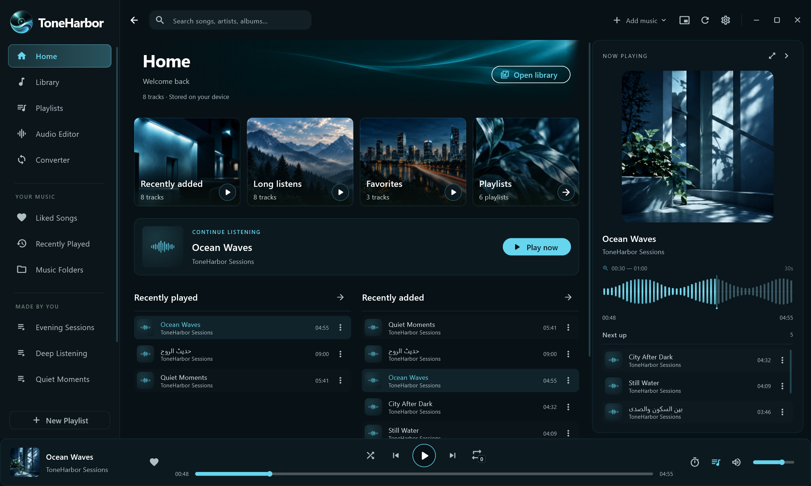
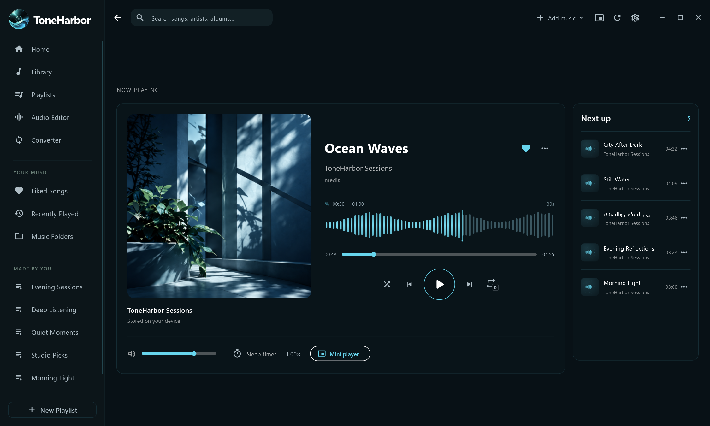
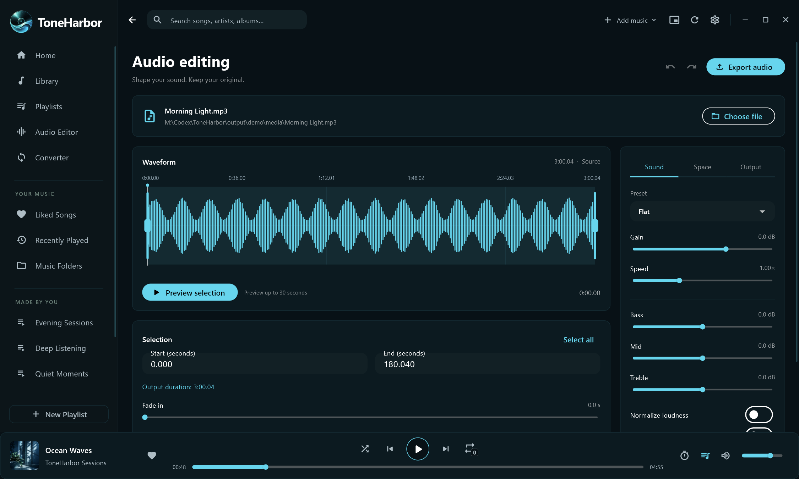

# ToneHarbor

English · [العربية](README.ar.md)

A desktop music player, batch converter and audio editing workspace for Windows, built with Flutter.



## Features

- Local library with search, sorting, albums, artists, folders, favorites and playlists.
- Multi-selection with Ctrl/Shift, long press and drag selection. Removing from Library and deleting original files are separate actions.
- Persistent playback, queue, sleep timer, speed controls and distinct repeat modes.
- Full player and a frameless, always-on-top mini player with adjustable opacity.
- Real audio waveforms with bounded 30-second windows.
- Batch video-to-audio conversion and audio export, with progress and cancellation.
- Audio editor with waveform selection, exact trim, undo/redo, preview, EQ, normalization, denoising, fades and spatial effects.
- Five themes, customizable artwork and editable keyboard shortcuts.
- English, Arabic and Persian interfaces, with compact and ultrawide layouts.
- Windows **Open with** and single-instance file opening. Default associations remain the user's choice.

## Listening workspace



[View all screenshots](docs/SCREENSHOTS.md) · [الصفحة العربية](README.ar.md)

## Download for Windows

[Download ToneHarbor 1.1.4](https://github.com/MhDTam/ToneHarbor/releases/tag/v1.1.4). Extract the ZIP and run ToneHarbor.exe. This portable build needs no Flutter SDK. FFmpeg is a separate dependency for waveforms, editing and conversion; see the release instructions.

## Supported platform

Windows x64 is the maintained and tested target. Other platform projects are not included. Shared Dart code contains platform adapters, but this repository does not promise builds for those platforms.

Playback depends on Windows codecs and the audio backend. MP3, WAV, FLAC, M4A/AAC, OGG, OPUS and WMA are recognized extensions; an extension does not guarantee support for every codec inside that container. FFmpeg is required for conversion, editing and waveform decoding.

## Build from source

Install the [Flutter Windows toolchain](https://docs.flutter.dev/platform-integration/windows/setup), including Visual Studio's **Desktop development with C++** workload. Validated SDK: **Flutter 3.47.5 / Dart 3.13.4**, recorded in [.flutter-version](.flutter-version). Keep [pubspec.lock](pubspec.lock) for locked dependencies.

Install an FFmpeg build with MP3, AAC, FLAC, Vorbis and Opus encoders on `PATH`, or put `ffmpeg.exe` in `tools/`. See [tools/README.md](tools/README.md). Native executables are excluded from Git.

```powershell
git clone https://github.com/MhDTam/ToneHarbor.git
cd ToneHarbor
flutter pub get --enforce-lockfile
flutter analyze --no-pub
flutter test --no-pub
flutter run -d windows --no-pub
```

Build a portable Windows directory:

```powershell
pwsh -File tool/build_windows.ps1
```

The result is `dist/ToneHarbor/`. Keep its executable, DLLs and `data/` together. The script includes project and dependency notices. FFmpeg is **not** bundled by this script; use `PATH` or add your own properly licensed build. Publish binaries in GitHub Releases, rather than in source commits.

## Audio editor



The editor exports to a new file and protects existing outputs. Preview renders up to 30 output seconds into temporary storage and does not replace the main music queue. The waveform shows amplitude over time, rather than a live frequency spectrum.

Screenshots are captured from the running Windows app using generated demo audio and an isolated profile. The displayed waveforms are decoded from those files by FFmpeg.

## Development and publishing

See [CONTRIBUTING.md](CONTRIBUTING.md), [architecture](docs/ARCHITECTURE.md) and [source publication instructions](docs/PUBLISHING.md). GitHub Actions checks analysis, tests and the Windows build. Remote CI results exist only after a repository is uploaded and a workflow runs.

Preferences, databases, personal media, signing files, local design archives and previous builds are excluded from the source export.

## License

Project-owned code, documentation and original artwork are available under the [MIT License](LICENSE), unless a file carries a separate notice. Dependencies retain their own terms; see [THIRD_PARTY_NOTICES.md](THIRD_PARTY_NOTICES.md).

FFmpeg is an external tool with its own license. The local reference build is GPL-3.0 and is not included in this source repository. Flutter and the packages in [pubspec.yaml](pubspec.yaml) power the interface, playback and storage.
