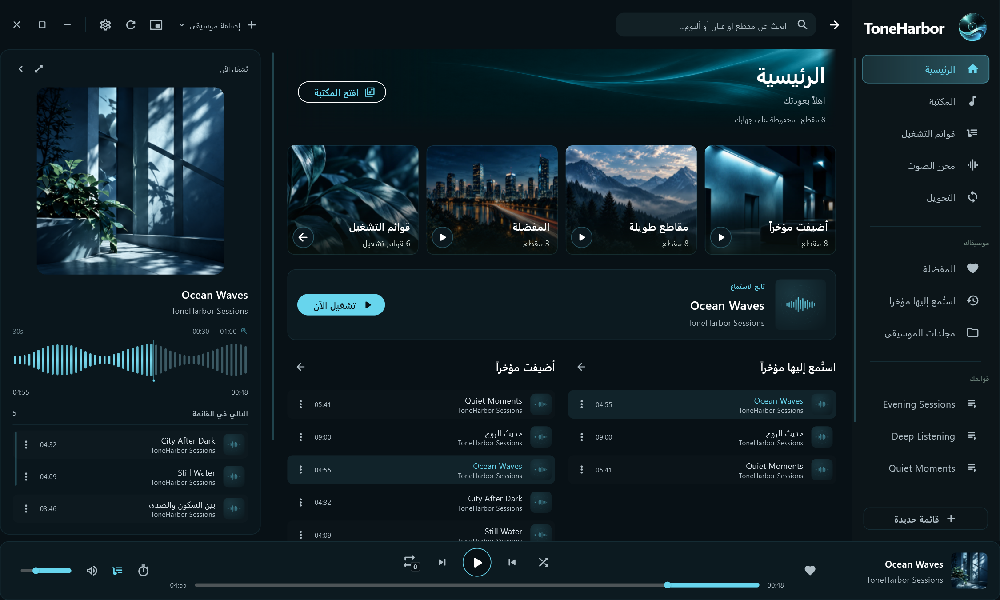

# Screenshots · ⁧صور البرنامج⁩

[English overview](../README.md) · [⁧الصفحة العربية⁩](../README.ar.md)

Captured from the running Windows application at 2250×1350. The app uses generated demo audio and an isolated, disk-backed profile. Playback and waveform decoding use the actual native audio backend and FFmpeg. These are live application captures, not widget-test renders or design mockups.

⁧لقطات من تطبيق ويندوز أثناء تشغيله، بدقة 2250×1350. استُخدمت ملفات صوت تجريبية وملف بيانات معزول، مع تشغيل الصوت واستخراج الموجات عبر المحرك الفعلي وFFmpeg. الصور ليست نماذج تصميم أو صوراً مولّدة من اختبارات الواجهة.⁩

## Home · ⁧الرئيسية⁩

## Arabic interface · ⁧الواجهة العربية⁩

## Library · ⁧المكتبة⁩

## Full player · ⁧المشغّل الكامل⁩

## Playlists · ⁧قوائم التشغيل⁩

## Audio editor · ⁧محرّر الصوت⁩

## Themes and settings · ⁧الثيمات والإعدادات⁩

