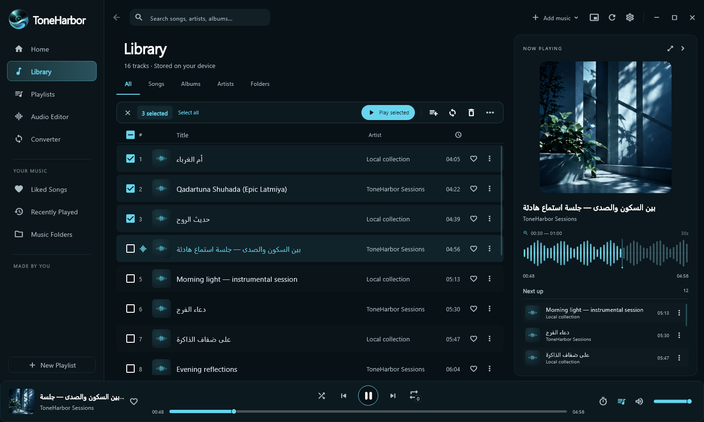
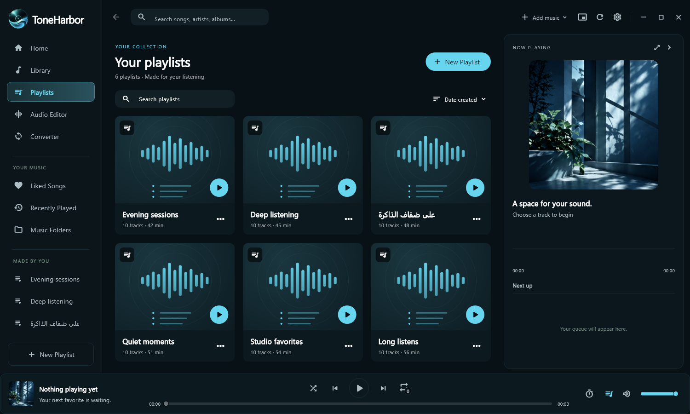
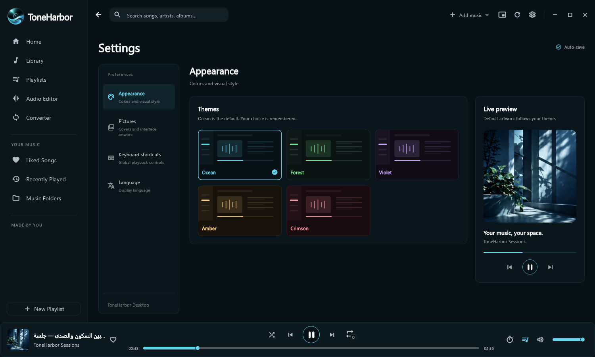

# Screenshots · ⁧صور البرنامج⁩

[English overview](../README.md) · [⁧الصفحة العربية⁩](../README.ar.md)

Production Flutter widget renders with sample library entries and fixture waveforms. These are interface previews, not captures of a private music library.

⁧صور من واجهات البرنامج باستخدام بيانات اختبار وموجات توضيحية، وليست تصويراً لمكتبة مستخدم شخصية.⁩

## Home · ⁧الرئيسية⁩

## Library and multi-selection · ⁧المكتبة والتحديد المتعدد⁩

## Full player · ⁧المشغّل الكامل⁩

## Playlists · ⁧قوائم التشغيل⁩

## Audio editor · ⁧محرّر الصوت⁩

## Themes and settings · ⁧الثيمات والإعدادات⁩

